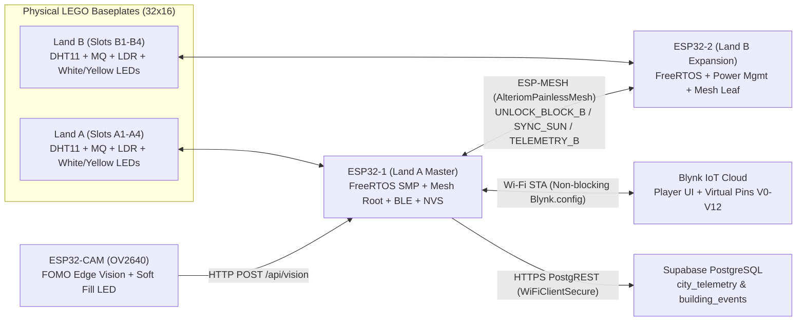
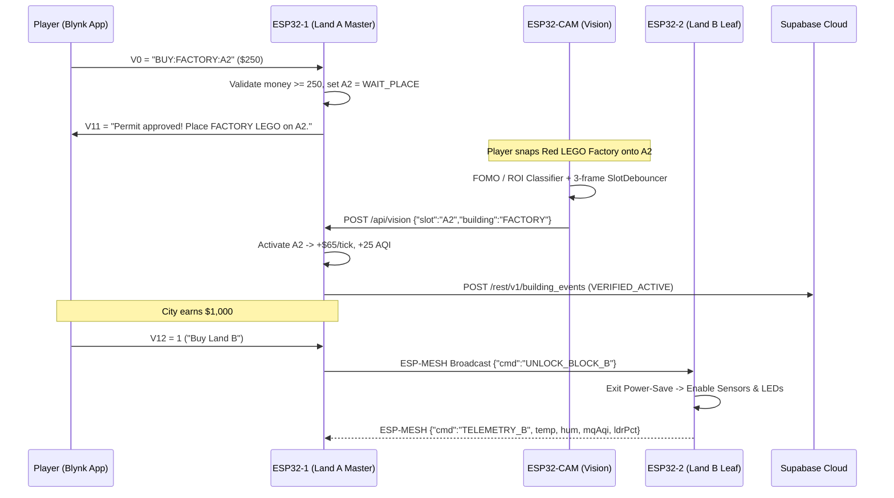

# Full_Explanation.md — BlockCity RTOS: Complete Technical Architecture & Implementation

**Project Title:** BlockCity RTOS: A Tangible Smart City Simulation Using ESP-MESH, Edge Vision, and Blynk  
**Repository:** [IOT9-BlockCity-RTOS](https://github.com/Jack-of-all-trades-04/IOT9-BlockCity-RTOS)

---

## 1. Project Overview & Physical–Digital Twin Philosophy

**BlockCity RTOS** is a hybrid **Physical–Digital Twin** smart city simulation built on three ESP32 nodes, real environmental sensors, physical LEGO bricks, edge computer vision (**FOMO**), and cloud telemetry (**Blynk IoT + Supabase**).

Rather than relying on fragile robotic arms to snap LEGO bricks onto a board (which suffer from high clutch-power friction and servo stall currents), BlockCity RTOS implements a **Tangible User Interface (TUI)**:
1. Players manage finances and purchase **Building Permits** in the **Blynk IoT** mobile/web dashboard.
2. Players physically place real **LEGO buildings** onto an 8-slot modular city baseplate (**Land A: `A1–A4`**, **Land B: `B1–B4`**).
3. An overhead **ESP32-CAM** verifies brick class and grid slot using **Edge Impulse FOMO** (or the built-in RGB ROI fallback prior to training) and notifies **ESP32-1** over HTTP.
4. Both **ESP32-1 (Land A)** and **ESP32-2 (Land B)** continuously measure real ambient **temperature & humidity (DHT11)**, **air quality/smoke (MQ Gas)**, and **sunlight intensity (LDR)** while driving **White + Yellow Sun/Streetlamp LEDs**.
5. Once the city earns **$1,000**, the player unlocks **Land B** via Blynk, waking **ESP32-2** over **ESP-MESH** (`AlteriomPainlessMesh`), expanding the playable grid to 8 lots and enabling dual-land sensor fusion.

---

## 2. System Architecture & Data Flow

### 2.1 Three-Node Hardware & Network Topology

### 2.2 Permit-and-Place & Expansion Sequence

---

## 3. Hardware Design, Per-Land Pinout & Power Budget

### 3.1 Bill of Materials (BOM)

| Qty | Component | Role |
| :--- | :--- | :--- |
| 2 | LEGO 16×16 Baseplates + Colored LEGO Bricks | Modular Land A (`A1–A4`) & Land B (`B1–B4`) physical city |
| 2 | ESP32 DevKit V1 (`nodemcu-32s`) | Land A Master (`ESP32-1`) and Land B Expansion (`ESP32-2`) |
| 1 | ESP32-CAM + `-MB` USB Programmer | Overhead OV2640 vision scanner + soft-fill LED (`GPIO4`) |
| 2 | DHT11 Temperature & Humidity Sensors | Per-land microclimate sensing (Land A & Land B) |
| 2 | MQ Gas Sensors (MQ-135 / MQ-2) + 1kΩ & 2kΩ Resistors | Per-land analog gas sensing with 5V→3.3V voltage divider |
| 2 | LDR Photoresistors + 10kΩ Resistors | Per-land ambient daylight measurement (3.3V divider) |
| 4+ | White & Yellow LEDs + 2× NPN Transistors (2N2222/BC547) + 220Ω–330Ω | Per-land dynamic Dawn/Noon/Dusk/Night Sun & Streetlamp PWM |
| 1 | 5V 2A–3A Dedicated Supply + MH Breadboard Adapter (7.5–9V DC) | Separate logic & heater rails with common GND to prevent brownouts |

### 3.2 Symmetric Per-Land Pinout (`include/pin_config.h`)

Both **ESP32-1 (Land A)** and **ESP32-2 (Land B)** use identical pin assignments:

| Signal | GPIO | Direction / Peripheral | Hardware Notes |
| :--- | :--- | :--- | :--- |
| `PIN_DHT` | `GPIO 21` | Digital Bidirectional | DHT11 data line (add 4.7k–10kΩ pull-up if bare 4-pin module) |
| `PIN_MQ_AO` | `GPIO 34` | `ADC1_CH6` (Input Only) | MQ 5V `AO` stepped down via `1kΩ` (top) + `2kΩ` (to GND) → max `3.33V` |
| `PIN_LDR_AO` | `GPIO 35` | `ADC1_CH7` (Input Only) | 3.3V → LDR → `GPIO35` → `10kΩ` → GND |
| `PIN_LED_WHITE` | `GPIO 25` | `LEDC` PWM (5 kHz, 8-bit) | Drives NPN transistor base via 220–330Ω resistor (Noon White bank) |
| `PIN_LED_YELLOW` | `GPIO 26` | `LEDC` PWM (5 kHz, 8-bit) | Drives NPN transistor base via 220–330Ω resistor (Dawn/Dusk/Streetlamp) |
| `PIN_STATUS_LED` | `GPIO 27` | Digital Output | Heartbeat on Land A; Lock pulse / Solid active on Land B |
| `PIN_FAN_ALERT` | `GPIO 32` | Digital Output | Active HIGH when `cityAqi > 150` (triggers exhaust fan/buzzer) |
| `PIN_WAKE_BTN` | `GPIO 33` | Digital Input (`INPUT_PULLUP`) | Land B manual hello/hot-plug trigger |

> **Why ADC1 Only?** On ESP32, **ADC2 channels cannot be read while Wi-Fi or ESP-MESH is active**. Placing MQ and LDR exclusively on `GPIO34` and `GPIO35` (`ADC1`) guarantees reliable analog readings at all times.

### 3.3 Voltage Divider & Power Rail Safety
- **MQ Gas Divider:** $V_{\text{ADC}} = V_{\text{AO}} \times \frac{2\text{ k}\Omega}{1\text{ k}\Omega + 2\text{ k}\Omega} = 5.0\text{ V} \times \frac{2}{3} = 3.33\text{ V}$, protecting the 3.3V ESP32 GPIO from over-voltage.
- **Anti-Brownout Powering:** Two MQ heaters (~150 mA each) plus Wi-Fi TX bursts (~300–400 mA per ESP32) exceed a single AMS1117 linear regulator's thermal limit if fed 12V. Feed the MH breadboard adapter with **7.5–9V DC**, power ESP32-CAM from a dedicated **5V 2A–3A** rail, and tie all **GND** rails together.

---

## 4. FreeRTOS SMP Firmware Architecture & 10/10 Syllabus Alignment

### 4.1 Task Allocation on ESP32-1 (`src/block_a/main_block_a.cpp`)

| Task Name | Core | Priority | Stack | Responsibility |
| :--- | :--- | :--- | :--- | :--- |
| `NetMesh` | Core 0 | 3 | 6144 B | `AlteriomPainlessMesh` update loop, mesh TX queue drain, non-blocking `Blynk.config()`/`Blynk.run()` |
| `HttpIngest` | Core 0 | 3 | 4096 B | HTTP server (`:8080`) handling `POST /api/vision`, `GET /api/state`, `POST /api/simulate` |
| `Supabase` | Core 0 | 1 | 6144 B | Consumes `supabaseQueue`, performs TLS `HTTPS POST` to Supabase PostgREST |
| `CityEngine` | Core 1 | 2 | 6144 B | Processes `visionEventQueue`, `meshRxQueue`, and `economyTickSemaphore` under `cityMutex`; persists NVS |
| `SensorA` | Core 1 | 2 | 3072 B | Reads Land A DHT11, 16× averaged MQ ADC1, and 16× averaged LDR ADC1 every 2.5 s |
| `SunPWM` | Core 1 | 1 | 3072 B | Computes Dawn/Noon/Dusk/Night PWM duties and broadcasts `SYNC_SUN` over ESP-MESH |
| `BleMayor` | Core 1 | 1 | 4096 B | Periodic 2-second passive BLE scan every 18 s for `MayorPhone` (`RSSI > -75 dBm`) |

### 4.2 Complete 10/10 Practicum Syllabus Coverage

| Module | Topic | Exact Implementation in BlockCity RTOS |
| :--- | :--- | :--- |
| **Modul 1** | Briefing & SMP | `xTaskCreatePinnedToCore()` splits networking (Core 0) from simulation/sensors (Core 1) |
| **Modul 2** | Task Management | Priority hierarchy: Network/HTTP (3) > CityEngine/Sensors (2) > SunPWM/Supabase/BLE (1) |
| **Modul 3** | Memory & Queue | `visionEventQueue`, `meshRxQueue`, `meshTxQueue`, `supabaseQueue`, plus PSRAM camera buffers |
| **Modul 4** | Deadlock & Sync | `cityMutex` (`xSemaphoreCreateMutex()`) guards shared `CityState` with bounded 100–200 ms timeouts |
| **Modul 5** | Software Timer | Auto-reloading `xTimerCreate()` callbacks (`EconTick` 10 s, `SunCycle` 2 s) without `delay()` stalls |
| **Modul 6** | Bluetooth & BLE | `taskBleMayor` detects Mayor phone RSSI to grant `+10%` city tax boost (`mayorOnSite`) |
| **Modul 7** | MQTT, HTTP & Wi-Fi | Wi-Fi STA + HTTP REST (`/api/vision` from ESP32-CAM & HTTPS REST to Supabase PostgREST) |
| **Modul 8** | Power Management | `esp_wifi_set_ps(WIFI_PS_MAX_MODEM)` & sensor/LED standby on ESP32-2 while Land B is locked |
| **Modul 9** | IoT Platform (Blynk) | Blynk Cloud template (`V0–V12`) for permits, gauges, live alerts, and optional Node-RED bridge |
| **Modul 10** | ESP-MESH | `AlteriomPainlessMesh` links ESP32-1 (Root) and ESP32-2 (Leaf) for expansion, sun sync & telemetry |

---

## 5. Simulation Mechanics & Environmental Equations

### 5.1 Economy & Building Ruleset (`include/city_protocol.h`, `include/city_logic.h`)

| Building / Action | Cost | Base Income / 10s Tick | AQI Delta | Special Mechanics |
| :--- | :--- | :--- | :--- | :--- |
| **House (`HOUSE`)** | `$100` | `+$20` | `+2 AQI` | Income **halved (-50%)** if `cityAqi > 150` |
| **Factory (`FACTORY`)** | `$250` | `+$65` | `+25 AQI` | High tax revenue, strong smog contributor |
| **Green Park (`PARK`)** | `$150` | `-$5` (upkeep) | `-18 AQI` | Offsets factory smog and cancels +0.5°C Urban Heat |
| **Solar Farm (`SOLAR`)** | `$300` | `+$30 × (LDR% / 100)` | `0 AQI` | Zero output at night (`isNight == true`) |
| **Buy Land B** | `$1,000` | Unlocks `B1–B4` | Enables Land B MQ | Broadcasts `UNLOCK_BLOCK_B` over ESP-MESH |

Additional rules:
- **Illegal Construction:** Placing a LEGO brick without an active `SLOT_WAITING_PLACEMENT` permit marks the slot `SLOT_ILLEGAL`, logs a Blynk `illegal_build` warning, and yields **$0 income** until removed or permitted.
- **Selling:** `SELL:<SLOT>` refunds **50%** of building cost and transitions the slot to `SLOT_WAITING_REMOVAL` until ESP32-CAM confirms the slot is empty again.
- **Night Streetlights:** When `sunPhase > 75` or average `LDR < 20%`, `isNight = true`, streetlights glow warm yellow (`duty = 50/255`), and `-$10/tick` municipal electricity upkeep is deducted.
- **Mayor BLE Boost:** When `mayorOnSite == true`, positive gross building income receives a **+10%** multiplier.

### 5.2 Hybrid AQI & Urban Heat Island Equations
- **Hybrid Air Quality Index:**
  $$\text{AQI}_{\text{city}} = \max\left(0,\ \overline{\text{AQI}}_{\text{MQ}} + \sum_{i \in \text{Active}} \Delta\text{AQI}_i\right)$$
  where $\overline{\text{AQI}}_{\text{MQ}}$ uses Land A's MQ reading while locked, and averages Land A + Land B MQ readings once Land B is unlocked and online.
- **Urban Heat Island (UHI):**
  $$T_{\text{eff}} = T_{\text{DHT11}} + \max(0,\ N_{\text{non-park}} - N_{\text{park}}) \times 0.5^\circ\text{C}$$

---

## 6. ESP32-CAM Vision Pipeline (`src/esp32_cam/`)

1. **PSRAM Frame Capture:** Captures `240×240` RGB565 frames (`FRAMESIZE_240X240`) with `ledcWrite(CAM_FLASH_LED, 13)` soft-fill illumination.
2. **Dual Classifier Support (`fomo_config.h`):**
   - `USE_EDGE_IMPULSE_FOMO == 1`: Converts RGB565 → RGB888 in PSRAM and invokes `run_classifier()` (Edge Impulse FOMO MobileNetV2 int8).
   - `USE_EDGE_IMPULSE_FOMO == 0`: Uses `classifyRoiColorFallback()` across all 8 ROIs so full system integration can be tested immediately prior to dataset training.
3. **Centroid-to-Slot Mapping & Debouncing (`grid_mapper.h`):** Maps normalized `(cx, cy)` coordinates into slots `A1–A4` / `B1–B4` and requires **3 consecutive identical frames** (`SlotDebouncer`) before posting JSON to ESP32-1.

---

## 7. Verified Build & Unit Test Benchmarks

All logic unit tests and all three PlatformIO firmware targets were compiled and verified after the final code edit:

1. **Host Unit Tests (`test/test_city_logic.cpp`, `g++ -std=c++17`):** **7 / 7 test suites passed** (`testInitialState`, `testPermitAndPlaceWorkflow`, `testIllegalConstructionAndSell`, `testEconomySmogSolarNightAndBleBoost`, `testLandBExpansionAndHybridAqi`, `testSunPwmCrossfade`, `testGridMapperAndDebouncer`).
2. **PlatformIO Firmware Builds (`espressif32 @ 8.0.0`, `huge_app.csv`):**

| Environment | Target Board | RAM Used | Flash Used | Status |
| :--- | :--- | :--- | :--- | :--- |
| `block_a` | `nodemcu-32s` | `68,596 B` (**20.9%** of 320 KB) | `2,552,946 B` (**81.2%** of 3.0 MB app) | **SUCCESS** |
| `block_b` | `nodemcu-32s` | `52,608 B` (**16.1%** of 320 KB) | `1,642,558 B` (**52.2%** of 3.0 MB app) | **SUCCESS** |
| `esp32_cam` | `esp32cam` | `69,432 B` (**21.2%** of 320 KB) | `1,298,897 B` (**41.3%** of 3.0 MB app) | **SUCCESS** |
